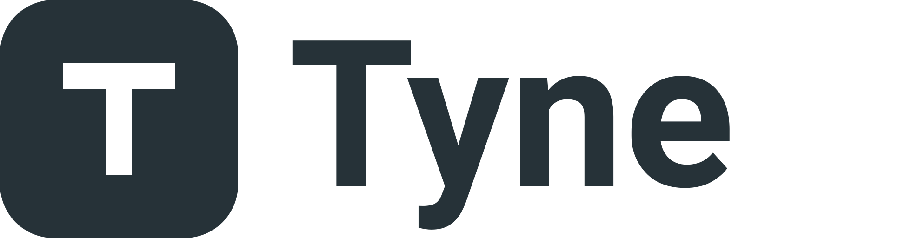

  

# Tyne

Tyne is a chat app for friends and communities, with its own server, web app and desktop app. It
is a fork of [Fluxer](https://github.com/fluxerapp/fluxer) that adds, among other things:

- **Personas**: several identities under one account, each with its own name and avatar, for
  plural systems and anyone else who writes as more than one person.
- **More desktop windows**: open a conversation in a window of its own, and get the same windows
  back the next time the app starts.

The Android app is in [tyne-chat/tyne-mobile](https://github.com/tyne-chat/tyne-mobile).

## Tyne and Fluxer

Tyne is an independent project. It is not affiliated with, endorsed by or supported by Fluxer
Platform AB. "Fluxer" and the Fluxer logo are trademarks of Fluxer Platform AB; this project uses
the name only to say what it is based on and what it works with, as
[Fluxer's name and marks policy](./GOVERNANCE.md#name-and-marks) allows. Because Tyne changes how
Fluxer works, that policy asks it to carry its own name and logo, and it does.

- Tyne is a modified version of Fluxer. Its changes are the commits on top of Fluxer's `main`
  branch; the first were made in 2026.
- The branch you are looking at, `tyne`, is rebuilt on top of Fluxer's latest code regularly, so
  its history is rewritten. Do not base long-lived work on it without expecting to rebase.
- A Tyne server speaks Fluxer's protocol with Tyne's additions. Features that only Tyne has, such
  as personas, need a Tyne server.
- Problems with Tyne belong in [this repository's issues](https://github.com/tyne-chat/tyne/issues),
  not with Fluxer.

Fluxer's own README is unchanged in the [repository root](../README.md), and so is its
documentation for building and self-hosting. Where they say Fluxer, the same steps apply to Tyne.

## Getting Tyne

Desktop builds for Windows, macOS and Linux are on the
[releases page](https://github.com/tyne-chat/tyne/releases). They are not code-signed, so your
system will ask before running them. The icon is a placeholder for now.

## Licence

Tyne is free software under the [GNU Affero General Public License, version 3 or later](../LICENSE),
the licence Fluxer is published under. Most of the code is copyright Fluxer Platform AB and its
contributors; Tyne's changes are copyright their authors. If you run a modified Tyne server for
other people, the licence requires you to offer them your source.

Artwork that comes from Fluxer is under [CC BY-SA 4.0](../fluxer_static/LICENSE). Third-party
material keeps its own terms, listed in
[fluxer_static/THIRD_PARTY_LICENSES.md](../fluxer_static/THIRD_PARTY_LICENSES.md).
